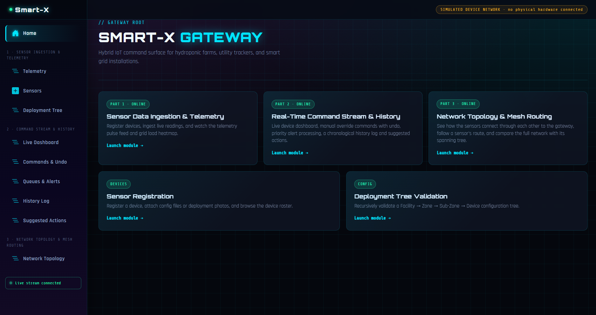
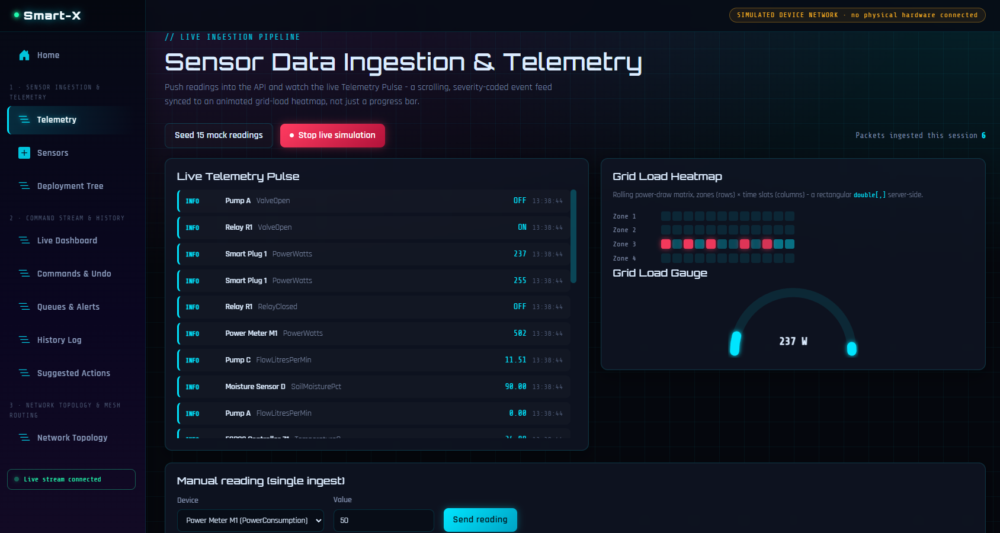
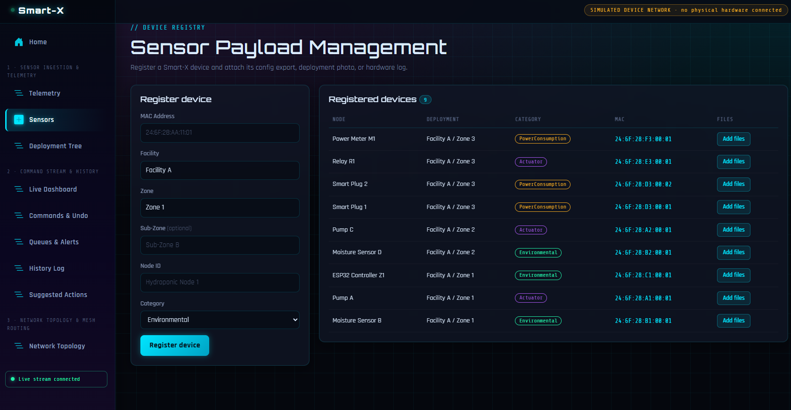
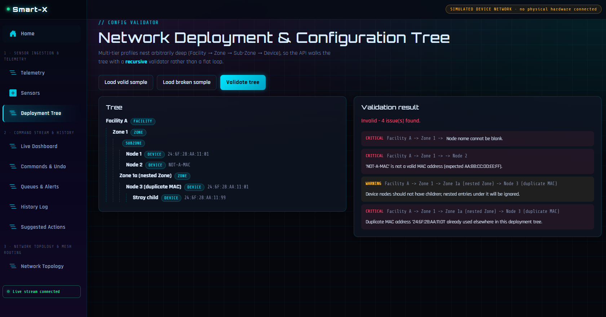
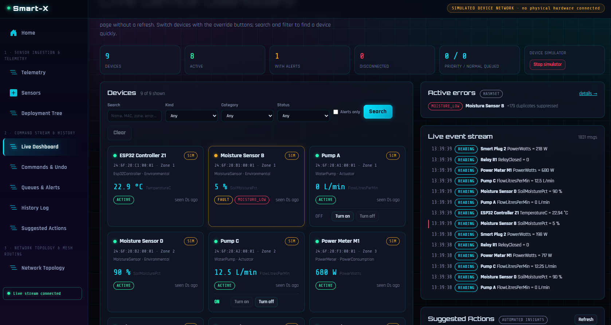
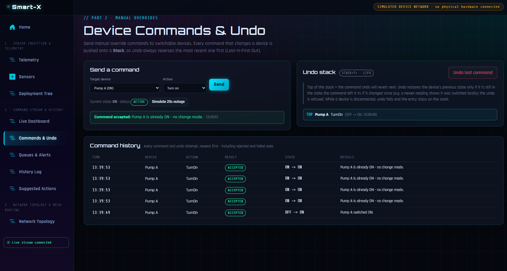
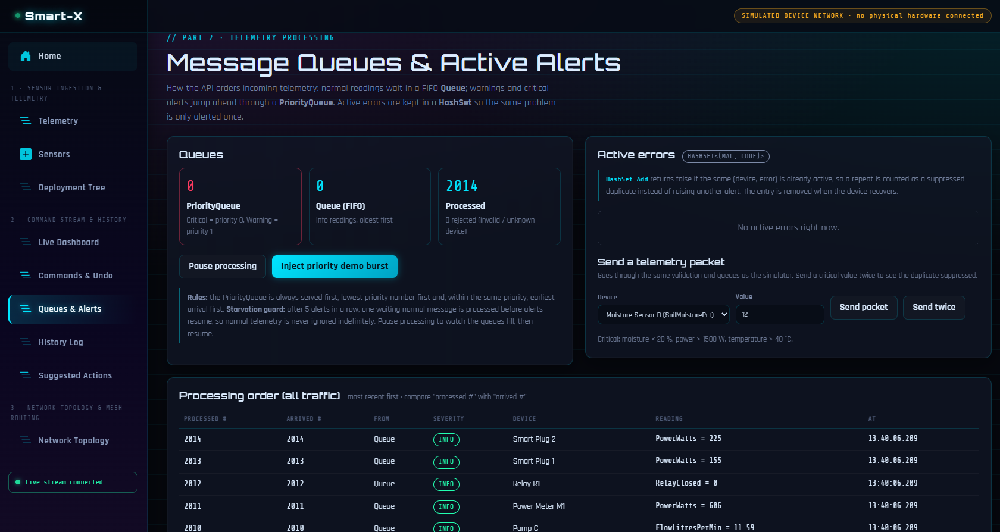
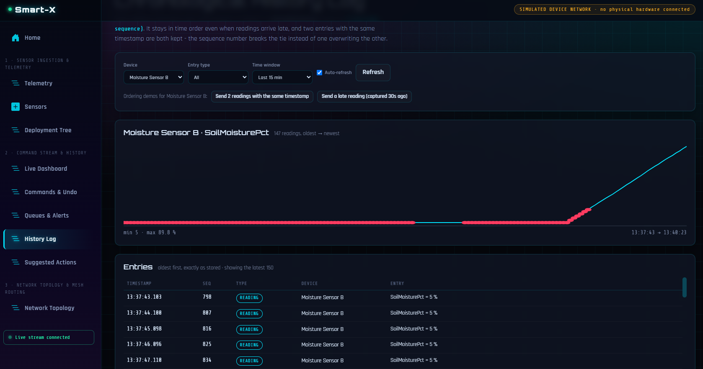
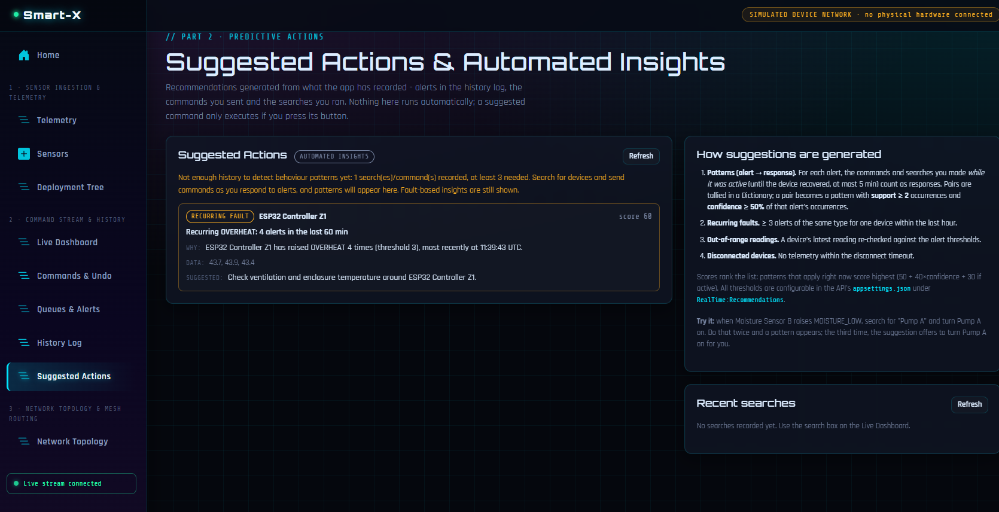
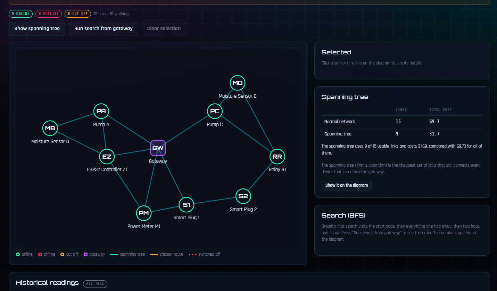

# Smart-X Gateway - Parts 1, 2 & 3

A dashboard and API to interface with the Smart-X environment (smart grids, utility trackers, hydroponic farms).

**Part 1 - Sensor Data Ingestion & Telemetry**

- Registration of devices
- Attachment of files
- Ingestion of telemetry
- Heatmap and the live pulse
- Recursive validation of deployment tree

**Part 2 - Real-Time Command Stream & History**

- Live dashboard for a device using Server-Sent Events
- Manual override with undo functionality
- Handling of priority alerts
- Logging of history in a timeline
- Searching and filtering
- Recommendation system ("Suggested Actions")

**Part 3 - Network Topology & Mesh Routing**

- Interactive diagram of the sensor mesh
- Due to distance from the gateway, certain sensors relay data via other sensors
- Path from each sensor to the gateway
- Minimum spanning tree of the sensor network
- Breadth-first search
- Historical data for each sensor is stored in an AVL tree

> **Simulation notice.** There are currently no real devices connected. Nine devices (based on ESP32s) are simulated within the API acting as a substitute for the actual devices (a controller, power meter, relay, smart plug, pump and moisture sensor). Within the UI, all simulated devices are marked as such. Simulated data is processed, queued and validated in the same way as data submitted to the API from outside. Additionally, within Part 3, on the topology page, both the location of the devices and the cost to connect them are simulated (see [Network topology and routing](#network-topology-and-routing-part-3)).

## Contents

1. [Architecture](#architecture)
2. [Requirements and setup](#requirements-and-setup)
3. [Running the application](#running-the-application)
4. [Configuration](#configuration)
5. [Using the application](#using-the-application)
6. [Screenshots](#screenshots)
7. [Part 2 data structures - where and why](#part-2-data-structures---where-and-why)
8. [Real-time updates (Server-Sent Events)](#real-time-updates-server-sent-events)
9. [Recommendation engine](#recommendation-engine)
10. [Part 3 data structures and algorithms - where and why](#part-3-data-structures-and-algorithms---where-and-why)
11. [Network topology and routing (Part 3)](#network-topology-and-routing-part-3)
12. [Testing each feature by hand](#testing-each-feature-by-hand)
13. [API reference](#api-reference)
14. [Automated tests](#automated-tests)
15. [Troubleshooting](#troubleshooting)
16. [Limitations and assumptions](#limitations-and-assumptions)
17. [Part 1 C# concepts](#part-1-c-concepts)
18. [References](#references)
19. [Third-party assets](#third-party-assets)

## Architecture

Smart-X is built with .NET 10 and has three projects:

- **API** - an ASP.NET Core Minimal API
- **Client** - a Blazor WebAssembly dashboard
- **Shared** - a class library used by both

How the browser and the API talk:

- Normal HTTP requests for reading data, commands and searches
- One long-lived Server-Sent Events (SSE) connection for live updates from the API

```
Smart-X/
├── SmartX.slnx                      solution file (API, client, shared library, tests)
├── docker-compose.yml
├── src/
│   ├── SmartX.Shared/               class library used by both API and client
│   │   ├── Enums/                   SensorCategory, DeviceKind, DeviceStatus, CommandAction, ...
│   │   ├── Generics/                TelemetryPacket<T>                         (Part 1)
│   │   ├── Aggregation/             MeterReading (overloaded operators)        (Part 1)
│   │   ├── Models/                  SensorRegistration, DeploymentNode, ...    (Part 1)
│   │   ├── Validation/              DeploymentTreeValidator (recursive)        (Part 1)
│   │   ├── Search/                  DeviceQuery - search/filter rules          (Part 2)
│   │   └── Dto/                     request/response and live-update contracts
│   ├── SmartX.Api/                  ASP.NET Core Minimal API
│   │   ├── Endpoints/               one file per route group
│   │   ├── Services/                Part 1 in-memory repositories and telemetry store
│   │   ├── RealTime/                Part 2: registry, queues, history, errors, commands,
│   │   │                            simulator, SSE broadcaster, recommendation engine
│   │   ├── Topology/                Part 3: AVL tree, reading history, mesh graph,
│   │   │                            BFS and Prim's algorithm, simulated layout
│   │   ├── SmartX.Api.http          ready-made example requests
│   │   └── appsettings.json         Part 2 thresholds and timings ("RealTime" section)
│   └── SmartX.Client/               Blazor WebAssembly dashboard
│       ├── Layout/                  sidebar navigation (three pillars) + live indicator
│       ├── Pages/                   Part 1 pages, Part 2 Stream* pages, Topology page
│       ├── Components/              DeviceCard, SuggestedActionsPanel, ApiErrorBanner, ...
│       └── Services/                SmartXApiClient (HTTP) and LiveDashboardState (SSE)
└── tests/
    └── SmartX.Tests/                xUnit tests for the Part 2 and Part 3 logic
```

### How a telemetry packet flows (Part 2)

```
device / simulator ──POST /api/stream/telemetry──▶ TelemetryProcessor.Enqueue
    validate (MAC format, Dictionary lookup, sensor type, value range)
    classify severity ──▶ Info: Queue<T>      Warning/Critical: PriorityQueue
                                    │
ProcessingWorker (every 300 ms) ───▶ dequeue: priority first (with starvation guard)
    update device state ─ add to HistoryLog (SortedDictionary)
    raise/clear active errors (HashSet) ─ forward to the Part 1 pulse feed and heatmap
    publish to LiveUpdateBroadcaster ──SSE /api/stream/live──▶ dashboard
```

### How the topology page gets its data (Part 3)

```
Part 2 device list (DeviceRegistry) ──▶ MeshTopology.Sync()
    one node per device + the gateway, online/offline from the device status
    links between nodes within radio range (positions from SimulatedLayout)
                                    │
topology page ──GET /api/topology, /route, /mst, /bfs──▶ MeshGraph + MeshAlgorithms
    BFS (Queue) for reachability and fewest-hops routes
    Prim (PriorityQueue) for the minimum spanning tree
                                    │
TelemetryProcessor ──every processed reading──▶ ReadingHistory (one AVL tree per sensor)
topology page ──GET /api/topology/readings/{id}?from=&to=──▶ tree range search
```

All data is kept **in memory**. There is no database. When the API restarts, these are reset:

- Devices
- History
- Commands
- Searches
- Stored readings

## Requirements and setup

| Software | Version | Needed for |
|---|---|---|
| [.NET SDK](https://dotnet.microsoft.com/download) | **10.0** (`dotnet --version` should show 10.x) | building, running and testing |
| A modern browser | Chrome, Edge or Firefox | the dashboard (needs streaming `fetch` support for SSE) |
| [Docker Desktop](https://www.docker.com/products/docker-desktop/) | optional | running both parts in containers |

- The NuGet packages restore by themselves
- No environment variables are needed to run it locally

```bash
git clone https://github.com/St10443269/prog7312-smartx.git
cd prog7312-smartx
dotnet restore SmartX.slnx
dotnet build SmartX.slnx
```

## Running the application

The API and the dashboard are two separate programs. Start both.

**Terminal 1 - API** (http://localhost:5190):

```bash
dotnet run --project src/SmartX.Api --urls http://localhost:5190
```

**Terminal 2 - dashboard** (http://localhost:5122):

```bash
dotnet run --project src/SmartX.Client --urls http://localhost:5122
```

Then open **http://localhost:5122**.

- The sidebar shows **"Live stream connected"** after a second or two
- The Live Dashboard starts showing readings
- If the API is not running, the pages show an "API problem" banner and the sidebar shows "Reconnecting..."
- The dashboard keeps trying and reconnects by itself when the API is back

In **Visual Studio** you can run both together instead:

- Right-click the solution and choose *Configure Startup Projects*
- Choose *Multiple startup projects*
- Set `SmartX.Api` and `SmartX.Client` to *Start*

Their launch profiles already use ports 5190 and 5122.

### Running with Docker

Start Docker Desktop first, then:

```bash
docker compose up --build
```

- API: http://localhost:5190
- Dashboard: http://localhost:8080

How it works:

- The client is a static Blazor WebAssembly build served by nginx
- The API runs in its own container
- The browser talks to the API (and its SSE stream) directly on port 5190
- `ClientOrigins__0` in `docker-compose.yml` lets the dashboard through CORS

To stop it, press `Ctrl+C`, then run `docker compose down`.

## Configuration

| Setting | File | What it does |
|---|---|---|
| `ApiBaseUrl` | `src/SmartX.Client/wwwroot/appsettings.json` | Where the dashboard finds the API (default `http://localhost:5190`). |
| `ClientOrigins` | API `appsettings.json` or env var `ClientOrigins__0` | Browser addresses allowed by CORS (default `http://localhost:5122` and `https://localhost:7163`). |
| `RealTime:Thresholds` | `src/SmartX.Api/appsettings.json` | Alert limits: moisture critical < 20 %, warning < 30 %; power spike > 1500 W, warning > 1000 W; overheat > 40 °C, warning > 35 °C; disconnected after 8 s of silence. |
| `RealTime:Processing` | same | Worker interval (300 ms), batch size (50), `MaxConsecutivePriority` (5), history limit (5000), `MaxReadingsPerSensor` (5000 readings per sensor in the AVL tree). |
| `RealTime:Simulator` | same | Start on launch, tick interval (1000 ms), random dropout chance. |
| `RealTime:Recommendations` | same | Pattern window (5 min), minimum times seen (2), minimum confidence (0.5), minimum history (3), recurring fault limit (3), lookback (60 min). |

You can also change any of these with environment variables, for example `RealTime__Thresholds__MoistureCriticalPct=15`.

The Part 3 topology settings are not in `appsettings.json`. They are part of the simulated layout, so they are in code:

- Radio range (30 m) and where each device sits: [`SimulatedLayout.cs`](src/SmartX.Api/Topology/SimulatedLayout.cs)
- Link cost formula: `BuildCost` in [`MeshTopology.cs`](src/SmartX.Api/Topology/MeshTopology.cs)

## Using the application

- The sidebar groups the pages into the three parts
- Moving between pages does not reload the app
- The live connection, device states, search filters and selected history device stay the same when you change page

| Part | Page | What it does |
|---|---|---|
| 1 | **Telemetry** | Pulse feed, heatmap and gauge. Also shows the live simulated readings. |
| 1 | **Sensors** | Register a device (each field is checked and shows its own error) and attach files. Each device has a *Files* panel to upload, list and download files. A new device also joins the Part 2 network. |
| 1 | **Deployment Tree** | Recursive validation of a deployment tree. |
| 2 | **Live Dashboard** (`/stream`) | Device cards with live readings, status, alerts and ON/OFF buttons. Search and filters, active errors, live events, top suggestions, simulator on/off. |
| 2 | **Commands & Undo** (`/stream/commands`) | Send commands, see the undo stack, undo, simulate an outage, see the command history. |
| 2 | **Queues & Alerts** (`/stream/processing`) | Queue sizes, pause/resume, priority demo, processing order, active errors with duplicate counts, send your own packets. |
| 2 | **History Log** (`/stream/history`) | Timeline of events with a chart, filters and two ordering demos. |
| 2 | **Suggested Actions** (`/stream/insights`) | All suggestions with the reason for each, how they are made, and recent searches. |
| 3 | **Network Topology** (`/topology`) | Diagram of the sensor mesh. Click a sensor to see its details, its two routes to the gateway and its past readings. Click a line to switch a link off. Show the spanning tree, run a breadth-first search, take a sensor offline. |

### Simulated devices

| Device | MAC | Kind | Zone | Reports |
|---|---|---|---|---|
| Moisture Sensor B | `24:6F:28:B1:00:01` | MoistureSensor | Zone 1 | `SoilMoisturePct` (dries fast, so alerts appear soon after start-up) |
| Pump A | `24:6F:28:A1:00:01` | WaterPump | Zone 1 | `FlowLitresPerMin`. When ON, Zone 1 moisture rises. |
| ESP32 Controller Z1 | `24:6F:28:C1:00:01` | Esp32Controller | Zone 1 | `TemperatureC` (sometimes overheats) |
| Moisture Sensor D | `24:6F:28:B2:00:01` | MoistureSensor | Zone 2 | `SoilMoisturePct` |
| Pump C | `24:6F:28:A2:00:01` | WaterPump | Zone 2 | `FlowLitresPerMin` (starts ON) |
| Smart Plug 1 / 2 | `24:6F:28:D3:00:01` / `:02` | SmartPlug | Zone 3 | `PowerWatts` (sometimes spikes, about 0 W when OFF) |
| Relay R1 | `24:6F:28:E3:00:01` | Relay | Zone 3 | `RelayClosed` (0/1) |
| Power Meter M1 | `24:6F:28:F3:00:01` | PowerMeter | Zone 3 | `PowerWatts` (the Zone 3 plugs added together plus a base load) |

Commands change the simulated devices:

- Turn Pump A on and Moisture Sensor B goes up
- Turn a plug off and its power drops to about 0 W

## Screenshots

All screenshots show the application running with the simulated devices.

### Home



The home page has a card for each part. All three open from the sidebar.

### Part 1 - Sensor Data Ingestion & Telemetry



**Telemetry:** the live pulse, the grid load heatmap and the gauge.



**Sensors:** register a device and attach files with the **Add files** button.



**Deployment Tree:** the recursive validator found four issues in the broken sample.

### Part 2 - Real-Time Command Stream & History



**Live Dashboard:** device cards, active errors, the live event stream and the suggested actions.



**Commands & Undo:** the undo stack (last in, first out) and the command history.



**Queues & Alerts:** the normal queue, the priority queue, active errors and the processing order.



**History Log:** the chart and the entries in time order.



**Suggested Actions:** each suggestion shows why it was made.

### Part 3 - Network Topology & Mesh Routing



**Network Topology:** the gateway and the nine sensors. Click a sensor to see its route, press *Show spanning tree* to see the cheapest links, or press *Run search from gateway* to run the breadth-first search.

## Part 2 data structures - where and why

| Structure | Where | What it does and why |
|---|---|---|
| **`Queue<T>`** | [`TelemetryProcessor`](src/SmartX.Api/RealTime/TelemetryProcessor.cs) `_normalQueue` | Holds normal readings. First in, first out, so readings are handled in the order they arrive. Adding and removing is O(1). |
| **`PriorityQueue<TElement, TPriority>`** | [`TelemetryProcessor`](src/SmartX.Api/RealTime/TelemetryProcessor.cs) `_priorityQueue` | Holds warnings and critical alerts. The priority is `(level, arrival number)`. Level 0 is critical (power spike > 1500 W, moisture < 20 %, overheat > 40 °C) and level 1 is a warning. The smallest comes out first, so critical goes before warning, and the earlier arrival goes first when levels match. This queue is served before the normal one. |
| *Starvation guard* | `TryDequeueNext` | After 5 alerts in a row (`MaxConsecutivePriority`), one waiting normal reading is handled. So normal readings never wait forever. |
| **`Stack<T>`** | [`CommandService`](src/SmartX.Api/RealTime/CommandService.cs) `_undoStack` | Every command that changes a device is pushed. Undo takes the latest one off (last in, first out) and puts the device back how it was. Push, peek and pop are O(1). |
| **`Dictionary<TKey, TValue>`** | [`DeviceRegistry`](src/SmartX.Api/RealTime/DeviceRegistry.cs) `_devicesByMac` | Devices stored by MAC address. A packet finds its device in one lookup, not by going through a list. An unknown MAC gives a 404, not a crash. |
| **`SortedDictionary<TKey, TValue>`** | [`HistoryLog`](src/SmartX.Api/RealTime/HistoryLog.cs) `_entries` | Readings, commands, alerts and recoveries, kept in time order. The key is [`HistoryKey(Timestamp, Sequence)`](src/SmartX.Api/RealTime/HistoryLog.cs), so two entries with the **same time are both kept**. Late readings go in the right place. The log can be read from the front for charts without sorting again. |
| **`HashSet<T>`** | [`ActiveErrorTracker`](src/SmartX.Api/RealTime/ActiveErrorTracker.cs) `_active` | The errors that are active right now, as `(MAC, code)`, for example `(Smart Plug 1, POWER_SPIKE)`. Adding an error that is already there returns `false`, so the repeat is counted and not alerted again. The entry is removed when the device recovers. Old alerts stay in the history log. |

### Undo - rules and limitations

- Undo only works if the device is still how the command left it
- If a newer reading shows it changed (for example a plug was switched back on), undo is **refused** and that entry is dropped
- If the device is **disconnected**, undo **fails** and the entry stays on the stack to try again later
- An undo is not put on the stack, so pressing Undo twice undoes the last two commands (it is not a redo)
- A command that changes nothing (turning on something that is already on) is accepted but not put on the stack
- A reading taken **before** a command cannot overwrite what the command set

## Real-time updates (Server-Sent Events)

**Why SSE**

- Live updates only go from the API to the browser
- Commands go the other way as normal HTTP requests
- SSE is plain HTTP and is built into ASP.NET Core 10 (`TypedResults.ServerSentEvents`)
- No extra library is needed, so SignalR was not used

**Server** ([`StreamEndpoints`](src/SmartX.Api/Endpoints/StreamEndpoints.cs), [`LiveUpdateBroadcaster`](src/SmartX.Api/RealTime/LiveUpdateBroadcaster.cs))

- Each connection has its own small buffer that drops the oldest update when full, so a slow browser cannot hold up the API
- Every new connection starts with a full snapshot of devices, errors and queues
- A heartbeat is sent after 15 s of silence
- When the browser disconnects, the connection is removed

**Client** ([`LiveDashboardState`](src/SmartX.Client/Services/LiveDashboardState.cs))

- One connection per browser tab, shared by every page
- If the stream drops, or nothing arrives for 40 s, it reconnects after 1, 2, 4 ... up to 10 s
- The snapshot then brings it up to date
- Pages redraw at most every 250 ms, so a burst of readings does not slow the page

## Recommendation engine

[`RecommendationEngine`](src/SmartX.Api/RealTime/RecommendationEngine.cs) (`GET /api/insights`) only uses data the app has recorded.

Each suggestion shows:

- The device
- The issue
- **Why** it was made
- The data behind it
- A suggested action

Suggestions are **never run automatically**. If one includes a command, it only runs when the user presses its button.

1. **Behaviour patterns (alert -> response).**
   - Look at every alert in the last 60 minutes
   - Count the commands and searches the user made **while that alert was active** (until the device recovered, at most 5 minutes)
   - Tally each pair (trigger device + error, response device + action) in a Dictionary, and use a HashSet per alert so nothing is counted twice
   - A pair becomes a pattern when:
     - **support ≥ 2:** it was seen at least twice
     - **confidence ≥ 50 %:** it followed at least half of that trigger's alerts
   - This is the support/confidence idea from association-rule mining
   - Example: *"Moisture Sensor B raised MOISTURE_LOW 3 times; 2 of those times (67 %) you switched Pump A ON."*
   - If the trigger is active again right now, the suggestion offers that command
2. **Recurring faults.** At least 3 alerts of the same type for one device in the lookback window.
3. **Out-of-range readings.** The latest reading of each connected device is checked against the limits (for example low moisture -> turn on the pump in that zone).
4. **Disconnected devices.** Devices that sent nothing within the timeout.

**Score** (used to sort the list):

- Patterns: `50 + 40 × confidence (+30 if the trigger is active now) + min(count, 10)`
- Recurring faults: `40 + 5 × count`
- Critical out-of-range readings: 45
- Disconnected devices: 35
- Warning-level readings: 25

With fewer than 3 searches and commands recorded, the page says there is not enough history for patterns yet. It still shows the fault suggestions. All limits can be changed under `RealTime:Recommendations`.

## Part 3 data structures and algorithms - where and why

| Structure / algorithm | Where | What it does and why |
|---|---|---|
| **AVL tree** | [`AvlTree<TKey, TValue>`](src/SmartX.Api/Topology/AvlTree.cs), used by [`ReadingHistory`](src/SmartX.Api/Topology/ReadingHistory.cs) | Every processed reading goes into a tree for its sensor, keyed by time. After each insert the tree rotates so the two sides of every node differ in height by at most 1. This keeps it shallow even though readings arrive in time order (a plain binary search tree would become a long chain). A search like "Sensor A between 14:00 and 16:00" only visits the part of the tree in that range: O(log n + matches). |
| *Same timestamp* | `AvlTree.Insert` | If two readings have the same time, the second is added to the list on the same node, so neither is lost. |
| **Graph (adjacency list)** | [`MeshGraph`](src/SmartX.Api/Topology/MeshGraph.cs) | Each node (gateway or sensor) is a vertex and each wireless link is an edge. It is a `Dictionary` from a node's id to its neighbours, so finding neighbours does not mean checking every link. It can add nodes and links, list neighbours, and switch a node or link on or off. |
| **Breadth-first search (BFS)** | [`MeshAlgorithms.Bfs`](src/SmartX.Api/Topology/MeshAlgorithms.cs) | Uses a `Queue<T>` to visit the start node, then everything 1 hop away, then 2 hops, and so on. The first time it reaches a node is by the route with the fewest hops. Nodes it never reaches have no route. Used for the reachable and unreachable lists, the fewest-hops route and the "Run search" button. |
| **Prim's algorithm** | [`MeshAlgorithms.Prim`](src/SmartX.Api/Topology/MeshAlgorithms.cs) | Builds the minimum spanning tree. Start at the gateway and keep adding the cheapest link that reaches a new node. |
| **`PriorityQueue` (min-heap)** | inside `Prim` | The links waiting to be used go into .NET's built-in `PriorityQueue`, a binary min-heap. The cheapest link comes out first and nothing is sorted again. I used the built-in one because Part 2 already uses it for alerts. Add and remove are O(log n). |
| **`HashSet<T>`** | `Bfs` and `Prim` | Remembers which nodes are already visited or already in the tree. |
| **`LinkCost` (operator overloading)** | [`LinkCost`](src/SmartX.Api/Topology/LinkCost.cs) | A small struct with `+` and `<`, like `MeterReading` in Part 1. Costs are added with `+` and the priority queue orders links with `<`. |

**Why an AVL tree and not a list or the `SortedDictionary` from Part 2?**

- A `List` has to be checked item by item for a time range
- A `SortedDictionary` keeps things in order but cannot jump straight to a range
- The AVL tree skips whole branches
- The page shows this: for a 30-second range it says how many readings it found and how many stored readings it looked at (for example 35 of 203)

**The core of the range search** (from `AvlTree.cs`):

```csharp
visited++;

// only go left if smaller keys could still be in range
if (from.CompareTo(node.Key) < 0)
    Collect(node.Left, from, to, items, ref visited);

if (from.CompareTo(node.Key) <= 0 && node.Key.CompareTo(to) <= 0)
    items.AddRange(node.Values);

// only go right if larger keys could still be in range
if (to.CompareTo(node.Key) > 0)
    Collect(node.Right, from, to, items, ref visited);
```

**The core of Prim's algorithm** (from `MeshAlgorithms.cs`):

```csharp
while (waiting.TryDequeue(out var cheapest, out var cost))
{
    // the node may have joined the tree through a cheaper link already
    if (inTree.Contains(cheapest.To))
        continue;

    inTree.Add(cheapest.To);
    treeLinks.Add(cheapest.Link);
    total += cost;
    AddLinksFrom(graph, cheapest.To, inTree, waiting);
}
```

### The spanning tree is not the shortest route

- A minimum spanning tree keeps the **total cost of the whole network** as low as possible
- It still connects every sensor that can reach the gateway
- It does **not** give each sensor its own cheapest or shortest route

Example from the default layout:

- Moisture Sensor B reaches the gateway in 2 hops (cost about 8.3) through the full network
- Through the spanning tree it takes 3 hops (cost about 9.5)
- The whole tree is much cheaper: about 31.7 for 9 links, against about 69.7 for all 15 links

The page shows both routes for each sensor so the difference is easy to see.

## Network topology and routing (Part 3)

The **Network Topology** page draws the sensor mesh. Everything on it comes from the graph on the server. The page asks the API for the nodes, links, routes and spanning tree, then draws the answer.

- **Nodes.**
  - The gateway plus one node for each device in the Part 2 registry
  - A device registered later on the Sensors page appears by itself
  - A node is **online** or **offline** based on the device status from Part 2, so a device that stops reporting goes red here too
- **Links.**
  - Two nodes are linked when they are within the radio range (30 m)
  - Some sensors are too far from the gateway, so they reach it through other sensors
  - That is what makes it a mesh
- **Link cost.**
  - An estimate of the energy needed to send a message over the link
  - Radio energy grows roughly with the square of the distance (Heinzelman, Chandrakasan and Balakrishnan, 2000)
  - So `cost = distance² / 100`: short links are cheap, long links cost more
- **Simulated.**
  - There are no real radios
  - Positions are fixed in [`SimulatedLayout.cs`](src/SmartX.Api/Topology/SimulatedLayout.cs) and nothing is random
  - The page says this at the top
  - To use real signal data later, only that file and the cost formula need to change
- **A link works only if** it is switched on **and** both ends are online. Routes, BFS and the spanning tree only use working links.

**What the colours mean:**

| On the diagram | Meaning |
|---|---|
| Green circle | Online and can reach the gateway |
| Red circle | Offline |
| Amber circle | Online but **cut off**: every route to the gateway is broken |
| Purple square | The gateway |
| Cyan line | A working link |
| Thick green line | A link in the spanning tree (after pressing *Show spanning tree*) |
| Thick amber line | The route chosen for the selected sensor |
| Red dotted line | A link that has been switched off |
| Grey dashed line | A link that is on, but one end is offline |

**What happens when something fails:**

- If a device goes offline or a link is switched off, the routes and the spanning tree are worked out again on the next request
- Only what still works is used, and another route is taken if there is one
- If there is no other route, the sensor shows as **cut off**
  - Its routes say "No route"
  - BFS lists it under "Cannot be reached"
  - The spanning tree leaves it out
  - The page never draws an invalid route
- An empty network (only the gateway) or a network with one device also works: the spanning tree is empty or has one link

## Testing each feature by hand

Every request below is also in [`src/SmartX.Api/SmartX.Api.http`](src/SmartX.Api/SmartX.Api.http). Open it in Visual Studio and click *Send request*. The curl examples are for Git Bash. In PowerShell, use the `.http` file instead.

**Simulate telemetry packets.** The simulator sends one reading per device every second. To send your own:

```bash
curl -X POST http://localhost:5190/api/stream/telemetry -H "Content-Type: application/json" \
     -d '{"macAddress":"24:6F:28:B1:00:01","sensorType":"SoilMoisturePct","value":45}'
```

Or use **Queues & Alerts -> Send a telemetry packet**.

**Trigger a high-priority alert.** Send moisture `12` (critical drop) or plug power `1900` (severe spike). The reply says `Accepted into the priority queue (priority 0)`.

**Queue + PriorityQueue.** On **Queues & Alerts**:

1. Click *Pause processing*
2. Click *Inject priority demo burst*
3. Click *Resume processing*

The *Priority demo result* table shows the critical alert (sent 10th of 10) was handled **1st**, the warning **2nd**, and the eight normal readings after them in the order they were sent. Through the API: `POST /api/stream/processing/pause`, `POST /api/stream/demo/priority-burst`, `POST /api/stream/processing/resume`, then `GET /api/stream/processing`.

**Stack and undo.** On **Commands & Undo**:

1. Turn Pump A on, then turn Smart Plug 1 off. The stack shows the plug on top.
2. *Undo last command* restores the plug.
3. Undo again to restore the pump.
4. Undo once more. It is refused with "stack is empty".
5. To see the disconnect rule, send a command, click *Simulate 20s outage*, wait about 8 s and try Undo. It **fails** and the entry stays on the stack. When the device reconnects, Undo works.

**Dictionary.** `GET /api/devices/24-6f-28-a1-00-01` finds Pump A even with a different case and separator. Unknown MACs get a 404 for telemetry and commands.

**SortedDictionary.** On **History Log**, pick a device, then:

- *Send 2 readings with the same timestamp*: both rows show with the same time and next-to-each-other sequence numbers, marked "same timestamp - kept"
- *Send a late reading*: a reading from 30 s ago goes 30 s back in the timeline, not at the end

**HashSet.** Wait for Moisture Sensor B to drop below 20 % (about 15 s after start-up), or send moisture `12` twice with *Send twice*.

- **Queues & Alerts -> Active errors** shows one `MOISTURE_LOW` entry
- Its *duplicates suppressed* count keeps going up
- The history log has only one alert
- Turn Pump A on. Once moisture is back above 30 % the error goes away and a Recovery entry is logged.

**Disconnected devices.** Click *Simulate 20s outage* (Commands page), or `POST /api/simulator/devices/{mac}/disconnect?seconds=20`. After 8 s the device shows **Disconnected**, gets a `DISCONNECTED` error, commands to it fail, and it recovers on its own.

**Search and filter.** On the **Live Dashboard**, type `pump` and press *Search*, or pick Kind / Category / Status / *Alerts only*.

- The search runs on the API and is saved for the recommendations
- It updates live. With Status = Disconnected, a device appears the moment it drops out.
- Filters stay when you leave the page and come back

**Recommendations.**

1. Wait for Moisture Sensor B to raise `MOISTURE_LOW`
2. Search for `Pump A` and turn Pump A on
3. When it recovers, turn the pump off
4. Do it once more

On the third drop, **Suggested Actions** shows *"Repeated response pattern: MOISTURE_LOW on Moisture Sensor B -> switched Pump A ON"* with a *Turn on Pump A* button. Before there is any history it says "Not enough history to detect behaviour patterns yet".

**Network diagram (graph).** Open **Network Topology**. You see the gateway (purple square) with the nine devices around it. The lines are the links. Click a line to see its two ends and its cost.

**BFS.** Press *Run search from gateway*.

- Numbers appear on the nodes in the order the search visited them
- The *Search (BFS)* panel lists each node and how many hops away it is
- Select a sensor and press *Run search from here* to see what that sensor can reach

**Route to the gateway.** Click **Moisture Sensor B**. The *Route to the gateway* panel shows the fewest-hops route (2 hops) and the route through the spanning tree (3 hops). *Show on diagram* draws either one in amber.

**Minimum spanning tree (Prim).** Press *Show spanning tree*.

- The links chosen by the algorithm turn thick green and the others fade
- The *Spanning tree* panel compares the two networks: all links (15 links, cost about 69.7) against the tree (9 links, cost about 31.7)

**Rerouting.** Click a link on a sensor's route and press *Switch this link off*.

- The route changes to another way round
- The spanning tree is worked out again
- Switch off every link of a sensor and it turns amber (cut off), its routes say "No route" and BFS lists it under "Cannot be reached"
- Press *Switch this link on* to restore it

**Offline devices.** Select a sensor and press *Simulate 20 s outage*. After about 8 seconds it turns red, routes of sensors that used it change, and it comes back by itself after the outage.

**AVL tree (historical readings).** Select a sensor and use the *Historical readings* panel.

- Pick a time range (or press *Last 30 sec*) and press *Search*
- The panel lists the readings and how many the tree looked at out of the total stored, for example "found 30 readings, the tree looked at 35 of the 203 stored readings"
- The API does the same: `GET /api/topology/readings/{mac}?from=...&to=...`

**Error handling.** Stop the API while the dashboard is open. The pages show an "API problem" banner, the sidebar shows *Reconnecting...* and nothing crashes. Start the API again and the stream reconnects by itself.

## API reference

- Base URL: `http://localhost:5190`
- Enums are sent as text (for example `"TurnOn"`)
- OpenAPI JSON is at `/openapi/v1.json` in Development

### Part 3

| Method | Route | What it does |
|---|---|---|
| GET | `/api/topology` | The whole network: nodes, links, who is online and who can reach the gateway |
| GET | `/api/topology/route/{id}` | One node's route to the gateway: fewest hops and through the spanning tree, with costs |
| GET | `/api/topology/mst` | Minimum spanning tree (Prim's algorithm) with its total cost compared to all links |
| GET | `/api/topology/bfs?from={id}` | Breadth-first search from a node (the gateway if `from` is left out) |
| POST | `/api/topology/links/up?a={id}&b={id}&isUp=true\|false` | Switch a link on or off |
| GET | `/api/topology/readings/{id}?from=&to=` | Readings for one sensor in a time range (AVL tree search). Default is the last 15 minutes. |

- `{id}` is the device's MAC address (for example `24:6F:28:B1:00:01`) or `GATEWAY`
- An unknown node gives 404
- A `from` later than `to` gives 400

### Part 2

| Method | Route | What it does |
|---|---|---|
| GET | `/api/devices?search=&kind=&category=&status=&alertsOnly=&record=` | Search and filter devices (`record=false` does not save the search) |
| GET | `/api/devices/{mac}` | One device by MAC |
| GET | `/api/devices/searches?take=` | Recent searches |
| POST | `/api/stream/telemetry` | Send a packet `{ macAddress, sensorType, value, capturedAtUtc? }` -> 202 / 400 / 404 |
| GET | `/api/stream/live` | **SSE** stream of live updates (`text/event-stream`) |
| GET | `/api/stream/processing` | Queue sizes and processing order |
| POST | `/api/stream/processing/pause` / `resume` | Pause or resume the processing worker |
| POST | `/api/stream/demo/priority-burst` | Queue 8 normal + 1 warning + 1 critical at once |
| POST | `/api/commands` | Command `{ macAddress, action: "TurnOn"\|"TurnOff" }` -> 200 accepted / 400 rejected / 404 unknown / 503 failed |
| POST | `/api/commands/undo` | Undo the latest command -> 200 / 409 / 503 |
| GET | `/api/commands?take=` | Command and undo history, newest first |
| GET | `/api/commands/stack` | Undo stack, top first |
| GET | `/api/history?mac=&kind=&minutes=&take=` | History in time order (oldest first) |
| GET | `/api/errors` | Active errors with duplicate counts |
| GET | `/api/insights` | Suggested actions |
| GET | `/api/simulator` | Simulator status |
| POST | `/api/simulator/start` / `stop` | Start or stop the simulator |
| POST | `/api/simulator/devices/{mac}/disconnect?seconds=` | Simulate a device outage |

Sensor types in a packet: `SoilMoisturePct` (0-100), `PowerWatts` (≥ 0), `FlowLitresPerMin` (≥ 0), `RelayClosed` (0 or 1), `TemperatureC` (-40 to 125).

### Part 1

| Method | Route | What it does |
|---|---|---|
| GET | `/api/sensors` | List registered sensors |
| POST | `/api/sensors` | Register a sensor (it also joins the Part 2 registry). The MAC must be six hex pairs with one kind of separator and is saved as `AA:BB:CC:DD:EE:FF`. Wrong fields give 400 with a message for each. A MAC that is already registered gives 409. |
| GET | `/api/sensors/{id}/attachments` | List the files on a sensor, newest first |
| POST | `/api/sensors/{id}/attachments` | Upload a file (multipart). Allowed: `.json .yaml .yml .txt .log .cfg .conf .png .jpg .jpeg .pdf`, up to 25 MB. |
| GET | `/api/sensors/{id}/attachments/{attachmentId}` | Download a file |
| POST | `/api/telemetry` | Send a single reading |
| POST | `/api/telemetry/batch` | Send a jagged batch of readings per device |
| POST | `/api/telemetry/seed` | Make mock readings for registered sensors |
| GET | `/api/telemetry/feed` | Recent telemetry pulse feed |
| GET | `/api/telemetry/aggregate/{nodeId}` | Total power load for a node |
| GET | `/api/telemetry/grid` | Zone-load heatmap |
| POST | `/api/deployment/validate` | Recursively validate a deployment tree |
| GET | `/api/deployment/sample` | A ready-made sample deployment tree |

## Automated tests

```bash
dotnet test tests/SmartX.Tests
```

> On Windows, **stop the API first**. A running API locks its files, and the test build fails with "file is being used by another process".

There are 148 xUnit tests:

- 56 for Part 2
- 54 for Part 3
- 38 for the Part 1 sensor rules, file rules and sensor store

They run against the real services with a fake clock and no web server.

The Part 2 tests cover:

- FIFO order, critical before normal, priority ties and the starvation guard ([`TelemetryProcessorTests`](tests/SmartX.Tests/TelemetryProcessorTests.cs))
- Bad packets and unknown devices
- MAC lookups and duplicate registration ([`DeviceRegistryTests`](tests/SmartX.Tests/DeviceRegistryTests.cs))
- Time order, equal timestamps, late packets and the limit ([`HistoryLogTests`](tests/SmartX.Tests/HistoryLogTests.cs))
- Duplicate errors, recovery and disconnects ([`ActiveErrorTrackerTests`](tests/SmartX.Tests/ActiveErrorTrackerTests.cs))
- Commands, undo and every case where undo is refused ([`CommandServiceTests`](tests/SmartX.Tests/CommandServiceTests.cs))
- Search and filter rules ([`DeviceQueryTests`](tests/SmartX.Tests/DeviceQueryTests.cs))
- Patterns, limits, "not enough data" and that nothing runs automatically ([`RecommendationEngineTests`](tests/SmartX.Tests/RecommendationEngineTests.cs))

The Part 3 tests cover:

- The AVL tree ([`AvlTreeTests`](tests/SmartX.Tests/AvlTreeTests.cs)):
  - All four rotation cases
  - 1000 keys added in order staying balanced
  - Duplicate keys
  - Range searches (both ends included, empty and backwards ranges, a big tree where only a few nodes are visited)
  - Removing the oldest
  - The empty tree
- Historical readings (`ReadingHistoryTests`, same file):
  - One sensor's readings between two times
  - Same timestamps and late arrivals
  - The size limit and unknown sensors
  - A processed packet ending up in the tree
- The graph, BFS and Prim's algorithm on small networks worked out by hand ([`MeshGraphTests`](tests/SmartX.Tests/MeshGraphTests.cs)):
  - Bad additions
  - Offline nodes and switched-off links
  - BFS levels and unreachable nodes
  - Fewest-hops routes
  - The spanning tree total (7 on the example network) and the same total from any start node
  - The tree route being longer than the direct route
  - Recalculating when a link fails and leaving out offline nodes
  - An empty network or a single node
- The topology service on the real device list ([`MeshTopologyTests`](tests/SmartX.Tests/MeshTopologyTests.cs)):
  - Routes through another node
  - A sensor being cut off when its relay goes offline, and coming back
  - Switching links off and on
  - Spanning tree changes and BFS lists
  - Devices added later
  - Networks with no devices or one device

The Part 1 sensor and file rules are covered by [`SensorInputTests`](tests/SmartX.Tests/SensorInputTests.cs):

- Good and bad MAC addresses (wrong length, not hex, no separators, mixed separators)
- Blank and too-long fields
- An unknown category
- Which file types are allowed and the size limit
- How file sizes are shown

[`SensorRepositoryTests`](tests/SmartX.Tests/SensorRepositoryTests.cs) checks the MAC lookup in the Part 1 sensor store.

The Blazor pages have no automated UI tests. They were checked by hand in the browser.

## Troubleshooting

| Problem | Cause and fix |
|---|---|
| `The provided file path does not exist: src/SmartX.Api` | The terminal is in the wrong folder. Run the commands from the project folder (the one with `SmartX.slnx`), for example `cd prog7312-smartx`. |
| `address already in use`, or the API or dashboard will not start | Something is already using port 5190 (API) or 5122 (dashboard), often an earlier copy. Close it (Ctrl+C in its terminal) or pick other ports with `--urls`. If you change the API port, also change `ApiBaseUrl` in `src/SmartX.Client/wwwroot/appsettings.json`. |
| `dotnet test` or `dotnet build` says "file is being used by another process" | The API is running and has locked its files. Stop the API, then build or test. |
| The pages show an "API problem" banner and the sidebar says *Reconnecting* | The dashboard cannot reach the API. Check the API is running on port 5190. It reconnects by itself when the API is back. |
| The browser blocks requests to the API (CORS error in the console) | The dashboard is on an address the API does not allow. Add it to `ClientOrigins` in the API's `appsettings.json` (or set the `ClientOrigins__0` environment variable). |
| `docker compose up --build` cannot connect to Docker | Docker Desktop is not started. Start it, wait until it says it is running, then try again. |
| A device on the topology page is red but nobody switched it off | The simulator drops a device at random now and then to test offline handling. It comes back by itself. To turn this off, set `RealTime:Simulator:RandomDisconnectChance` to `0` in `appsettings.json`. |
| Moisture Sensor B keeps showing an alert | It is set to dry out fast so alerts show soon after start-up. Turn Pump A on to raise its moisture. |
| The readings table is empty | The API has only just started, or the range has no readings. Press *Last 30 sec*. Readings are kept in memory, so they are lost when the API restarts. |

## Limitations and assumptions

- **No hardware and no saved data.** All devices are simulated. Everything is in memory and is lost when the API restarts.
- **One API instance.** The queues, stack and sets live in one process. Running several instances would need a shared store or message broker.
- **Alert levels use limits** for each sensor type. The Part 1 severity on the Telemetry page (based on how much a reading changed) is unchanged and separate.
- **Errors only clear when fully back to normal.** An error clears on an Info-level reading, so moisture must go above 30 %, not just above 20 %. This stops alerts flickering around the limit.
- **One undo stack for everyone.** There is no login. Anyone with the dashboard can send commands.
- **Only specific searches count for patterns.** A search counts only if it matched 1-3 devices. A search for everything says nothing about one device.
- **The mesh is simulated.**
  - Device positions are fixed in `SimulatedLayout.cs`
  - Links come from a made-up 30 m radio range
  - Link costs are an estimate from distance, not a measurement from real radios
  - Real signal data would replace `SimulatedLayout.cs` and the cost formula
- **One gateway, links set once.** A device's links are worked out when it first appears, so they do not change if positions change.
- **Switched-off links are not saved.** A link you switch off stays off until you switch it on or the API restarts.
- **Routes use hops or the spanning tree.** The page shows the fewest-hops route (BFS) and the route through the minimum spanning tree (Prim). It does not find the cheapest route for each sensor (that would need Dijkstra's algorithm).
- **Readings are kept in memory.** Up to 5000 readings are kept per sensor in the AVL tree. The oldest are removed after that, and all are lost when the API restarts.

## Part 1 C# concepts

| Requirement | Location |
|---|---|
| **Generics** | [`TelemetryPacket<T>`](src/SmartX.Shared/Generics/TelemetryPacket.cs): one generic class handles float, int and bool readings without boxing. |
| **Operator overloading** | [`MeterReading`](src/SmartX.Shared/Aggregation/MeterReading.cs): overloads `+`, `-`, `==`, `!=`, `>`, `<`, `>=`, `<=` so power readings can be added and compared directly (`Meter3 = Meter1 + Meter2`). Used in [`TelemetryStore`](src/SmartX.Api/Services/TelemetryStore.cs) for the severity and the running total of each node. |
| **Advanced arrays/lists** | Jagged `float[][]` batch ingestion in [`TelemetryStore.IngestFloatBatch`](src/SmartX.Api/Services/TelemetryStore.cs), and a rectangular `double[,]` zone-load grid behind the heatmap. |
| **Recursion** | [`DeploymentTreeValidator`](src/SmartX.Shared/Validation/DeploymentTreeValidator.cs): walks Facility → Zone → Sub-Zone → Device trees of any depth. |

The Part 1 **Telemetry** page's *Live Telemetry Pulse* (a feed coloured by severity, a zone heatmap and an SVG gauge) also shows the Part 2 simulated readings. This is because processed Part 2 packets are passed on to the Part 1 store.

## References

In-text citations in the source code (for example `(Microsoft, n.d.c)`) match the list below. Where one author has several sources in the same year, they are lettered a, b, c ... in the order used in this list.

Adelson-Velsky, G.M. and Landis, E.M. (1962) 'An algorithm for the organization of information', *Doklady Akademii Nauk SSSR*, 146(2), pp. 263-266.

Agrawal, R., Imieliński, T. and Swami, A. (1993) 'Mining association rules between sets of items in large databases', *Proceedings of the 1993 ACM SIGMOD International Conference on Management of Data*, Washington DC, 25-28 May. New York: ACM, pp. 207-216. doi: 10.1145/170035.170072.

Cormen, T.H., Leiserson, C.E., Rivest, R.L. and Stein, C. (2022) *Introduction to algorithms*. 4th edn. Cambridge, MA: MIT Press.

Espressif Systems (n.d.) *ESP32 Wi-Fi & Bluetooth SoC*, viewed 13 September 2026, <https://www.espressif.com/en/products/socs/esp32>.

Heinzelman, W.R., Chandrakasan, A. and Balakrishnan, H. (2000) 'Energy-efficient communication protocol for wireless microsensor networks', *Proceedings of the 33rd Annual Hawaii International Conference on System Sciences*, Maui, 4-7 January. Los Alamitos: IEEE Computer Society, pp. 1-10. doi: 10.1109/HICSS.2000.926982.

Internet Engineering Task Force (2014) *RFC 7252: The Constrained Application Protocol (CoAP)*, viewed 13 September 2026, <https://datatracker.ietf.org/doc/html/rfc7252>.

Microsoft (2025a) *Boxing and Unboxing (C# Programming Guide)*, Microsoft Learn, viewed 13 September 2026, <https://learn.microsoft.com/en-us/dotnet/csharp/programming-guide/types/boxing-and-unboxing>.

Microsoft (2025b) *ASP.NET Core Blazor Hosting Models*, Microsoft Learn, viewed 13 September 2026, <https://learn.microsoft.com/en-us/aspnet/core/blazor/hosting-models>.

Microsoft (2026) *Generic Types and Methods (C#)*, Microsoft Learn, viewed 13 September 2026, <https://learn.microsoft.com/en-us/dotnet/csharp/fundamentals/types/generics>.

Microsoft (n.d.a) *Minimal APIs Quick Reference*, Microsoft Learn, viewed 13 September 2026, <https://learn.microsoft.com/en-us/aspnet/core/fundamentals/minimal-apis>.

Microsoft (n.d.b) *Queue<T> Class*, Microsoft Learn, viewed 19 October 2026, <https://learn.microsoft.com/en-us/dotnet/api/system.collections.generic.queue-1>.

Microsoft (n.d.c) *PriorityQueue<TElement,TPriority> Class*, Microsoft Learn, viewed 19 October 2026, <https://learn.microsoft.com/en-us/dotnet/api/system.collections.generic.priorityqueue-2>.

Microsoft (n.d.d) *Stack<T> Class*, Microsoft Learn, viewed 19 October 2026, <https://learn.microsoft.com/en-us/dotnet/api/system.collections.generic.stack-1>.

Microsoft (n.d.e) *Dictionary<TKey,TValue> Class*, Microsoft Learn, viewed 19 October 2026, <https://learn.microsoft.com/en-us/dotnet/api/system.collections.generic.dictionary-2>.

Microsoft (n.d.f) *SortedDictionary<TKey,TValue> Class*, Microsoft Learn, viewed 19 October 2026, <https://learn.microsoft.com/en-us/dotnet/api/system.collections.generic.sorteddictionary-2>.

Microsoft (n.d.g) *HashSet<T> Class*, Microsoft Learn, viewed 19 October 2026, <https://learn.microsoft.com/en-us/dotnet/api/system.collections.generic.hashset-1>.

Microsoft (n.d.h) *Channels*, .NET documentation, Microsoft Learn, viewed 19 October 2026, <https://learn.microsoft.com/en-us/dotnet/core/extensions/channels>.

OASIS (2019) *MQTT Version 5.0*, OASIS Standard, viewed 13 September 2026, <https://docs.oasis-open.org/mqtt/mqtt/v5.0/mqtt-v5.0.html>.

OWASP Foundation (n.d.) *File Upload Cheat Sheet*, OWASP Cheat Sheet Series, viewed 13 September 2026, <https://cheatsheetseries.owasp.org/cheatsheets/File_Upload_Cheat_Sheet.html>.

Prim, R.C. (1957) 'Shortest connection networks and some generalizations', *Bell System Technical Journal*, 36(6), pp. 1389-1401. doi: 10.1002/j.1538-7305.1957.tb01515.x.

WHATWG (n.d.) *HTML Living Standard: Server-sent events*, viewed 19 October 2026, <https://html.spec.whatwg.org/multipage/server-sent-events.html>.

## Third-party assets

- **Bootstrap v5.3.3** (The Bootstrap Authors, MIT licence) in `src/SmartX.Client/wwwroot/lib/bootstrap`. It came with the Blazor WebAssembly project template.
- **Fonts:** Orbitron, Rajdhani and Share Tech Mono, loaded from Google Fonts (SIL Open Font Licence) in `src/SmartX.Client/wwwroot/index.html`.
